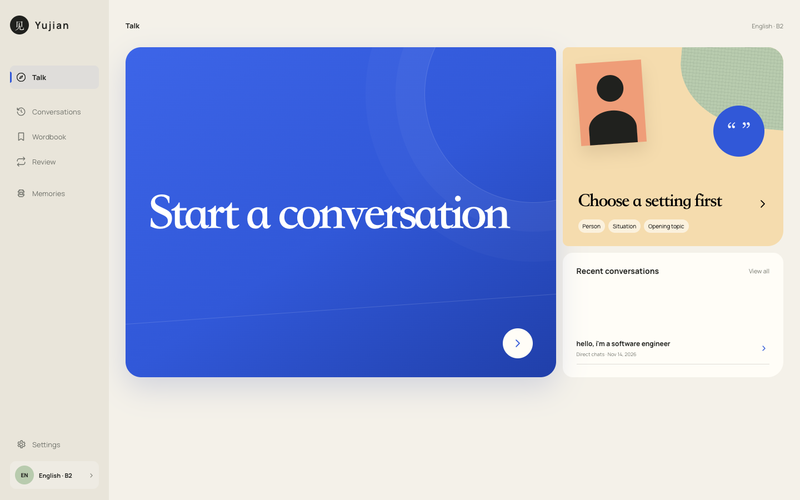
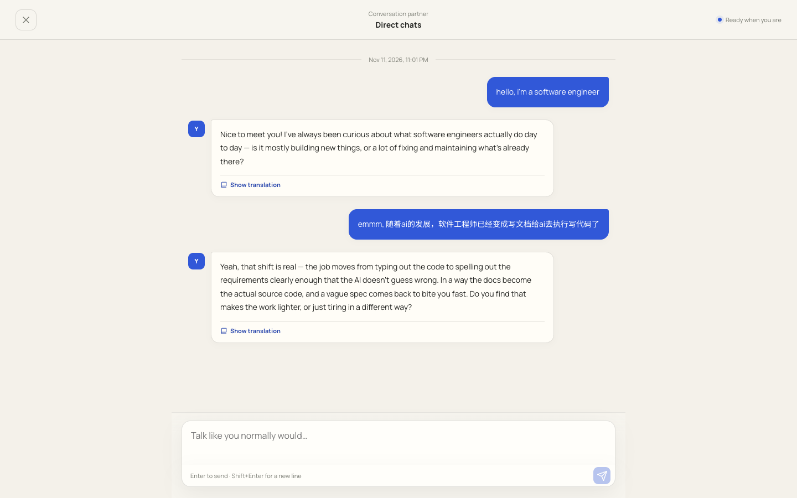
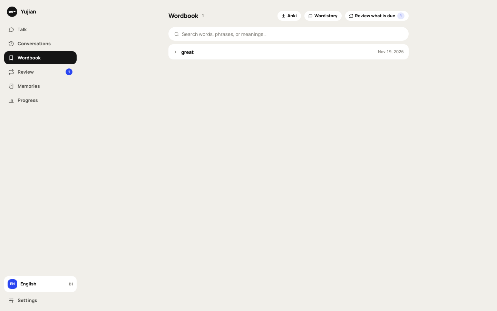
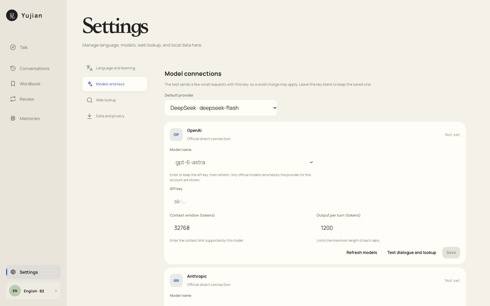

# Yujian · Local Language Coach

English · [简体中文](./README.zh-CN.md)

Practise a language on your own computer with the model you choose. Start with one sentence, then let conversations, corrections, saved words, reviews, and memory grow into one continuous learning path.



## Keep your attention on expressing yourself

- **Conversation comes first** — replies stay with the current thread, while corrections remain in the background.
- **Difficulty moves with you** — a placement test sets the starting point, then real performance shapes what comes next.
- **Every session leaves something useful** — saved words, recurring mistakes, recaps, and progress return in later practice.
- **You decide what is remembered** — nothing enters long-term memory without your confirmation.
- **Your model and data stay under your control** — choose your own model provider while learning records and API keys remain on your computer.

## Start freely or set the scene

Begin with whatever is on your mind, or choose a setting around daily life, travel, work, social situations, and more. Add a partner, situation, or opening topic when you want a clearer starting point.

A setting shapes the opening without turning the conversation into a fixed script.


## Corrections without breaking the conversation

Yujian responds to what you meant first, then places useful corrections beside your message. You can see a more natural version, understand what changed, and reveal a translation whenever you need it.

Select, double-click, or long-press unfamiliar text to look it up. If a reply feels difficult, ask for simpler wording or a hint without leaving the conversation.



## Turn encountered words into your wordbook

Only words you deliberately save enter the wordbook. Each one keeps its meaning, example, and original context, then returns for review according to how well you remember it.

Saved words can reappear in later conversations, become part of a short story, start a new discussion, or be exported to Anki.



## Remember only what you approve

When something may be useful later, Yujian asks before saving it. Memories are organised as core memory, personal preferences, learning notes, and conversation history. Every item can be edited, removed, or reprioritised.


## From conversation to review

- **Placement test** — reading, listening, and short written answers set an A1–C2 starting point; choosing a level directly is also possible.
- **Adaptive difficulty** — reply length and vocabulary follow the current level, with a separate level for every language.
- **Conversation recap** — see what went well, which corrections matter, and which saved words you used.
- **Personal practice** — build short exercises from your own mistakes and missing expressions.
- **Visible progress** — follow active days, message and word counts, level changes, and weekly comparisons.
- **Five minutes before bed** — end the day with a short, unhurried conversation.

## Practise with your voice

- **Voice input** — speak the message you want to send.
- **Call mode** — hear each reply aloud and continue hands-free.
- **Shadowing** — listen, repeat, and compare the words that came out differently.
- **Listen before reading** — hear a reply before revealing it, with slow and sentence-by-sentence playback.
- **Pronunciation playback** — hear replies, corrections, words, and examples when the browser provides a suitable voice.

## Choose your own model

Yujian supports OpenAI, Anthropic, Google Gemini, DeepSeek, and Moonshot / Kimi. It can also connect to OpenAI-compatible services or a model running locally.

The conversation model and recap model can be chosen separately. Connections are tested before they are saved, and API keys remain on the current computer.



## More useful features

- Keep the full conversation history and continue any earlier topic.
- Paste text or a link, look up words while reading, then talk about the material.
- Turn on web search only when a topic needs current information such as weather, events, or prices.
- See estimated model spending for each conversation and month.
- Create separate learner profiles for people sharing one computer.
- Back up learning data and export memories, conversations, and Anki-ready word lists.
- Use Yujian from a phone on the same Wi-Fi, or open temporary protected remote access.

## Supported languages

Languages to practise: English, Spanish, French, Japanese, German, Korean, Italian, Chinese, Portuguese, and Hindi.

Interface languages: Simplified Chinese, English, Latin American Spanish, French, Japanese, German, Korean, Italian, Brazilian Portuguese, and Hindi.

The interface and learning languages are independent. Correction notes, meanings, translations, and memories use the current interface language.

## Install

You need an API key from a supported model provider. The installer prepares the required environment and opens Yujian in the browser when it is ready.

macOS and Linux:

```bash
curl -fsSL https://raw.githubusercontent.com/yuanqishen666/local-language-coach/main/scripts/install.sh | sh
```

Windows (PowerShell):

```powershell
irm https://raw.githubusercontent.com/yuanqishen666/local-language-coach/main/scripts/install.ps1 | iex
```

### Mainland China network fallback

Use the mirror commands below when GitHub or the Node.js website is too slow.

macOS and Linux:

```bash
curl -fsSL https://gh-proxy.com/https://raw.githubusercontent.com/yuanqishen666/local-language-coach/main/scripts/install.sh | YUJIAN_GITHUB_MIRROR=https://gh-proxy.com YUJIAN_NODE_MIRROR=https://npmmirror.com/mirrors/node npm_config_registry=https://registry.npmmirror.com sh
```

Windows (PowerShell):

```powershell
$env:YUJIAN_GITHUB_MIRROR='https://gh-proxy.com'; $env:YUJIAN_NODE_MIRROR='https://npmmirror.com/mirrors/node'; $env:npm_config_registry='https://registry.npmmirror.com'; irm 'https://gh-proxy.com/https://raw.githubusercontent.com/yuanqishen666/local-language-coach/main/scripts/install.ps1' | iex
```

The fallback uses the third-party community services `gh-proxy.com` and npmmirror, which may sometimes be unavailable. Use a public proxy only for this public repository; never send a private repository address or access token through it.

You can also download the [latest source archive](https://github.com/yuanqishen666/local-language-coach/archive/refs/heads/main.zip), extract it, and run `npm start` inside the folder.

Run the same installer again to update while keeping existing learning data. When Yujian opens, choose the interface and learning languages, set your level, then add your model under **Settings → Models & keys**.

## Privacy

Conversations, saved words, reviews, memories, settings, and API keys stay on the current computer. Yujian includes no telemetry. Only the model provider you choose receives the content needed to produce the current reply.

Learning data can be backed up at any time. When several people share one computer, each learner keeps a separate conversation history, wordbook, memory, and level.

## Feedback

Share feature ideas and problems through [GitHub Issues](https://github.com/yuanqishen666/local-language-coach/issues). Never include an API key in a public report.

## License

This project is [non-commercial only](./LICENSE). Commercial use requires authorization from the author.
