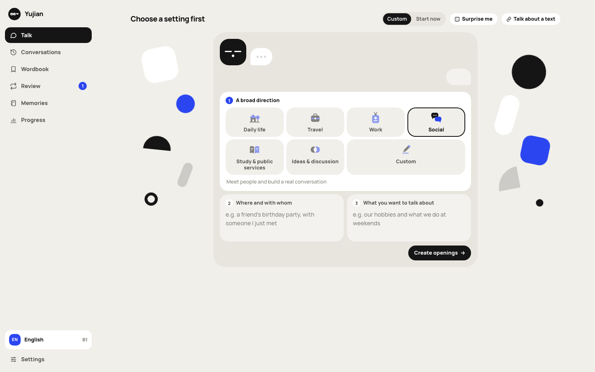
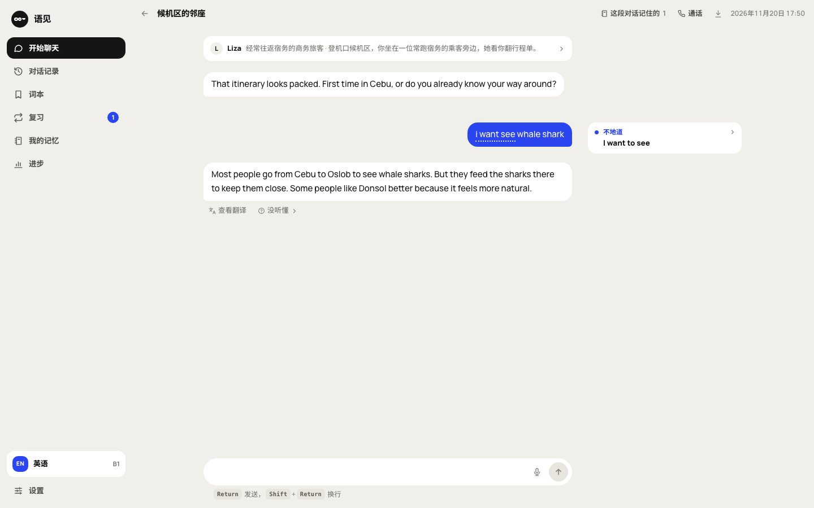
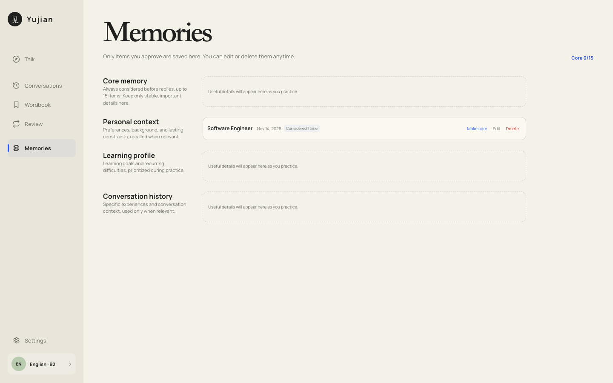

# Yujian · Local Language Coach

English · [简体中文](./README.zh-CN.md)

Practice conversations that can carry a thread—on your own computer, with the model you choose.

Start with your first sentence, or set up a conversation first. Yujian responds to what you said before offering corrections, definitions, or more natural phrasing. Anything remembered for later stays under your control.


## What you can do

- **Start talking immediately** — no lesson or task setup required.
- **Set up a conversation** — choose a theme, add a situation or topic, then pick a partner and opening, or let Yujian pick one for you.
- **Find your level and let the difficulty follow you** — a placement test of about ten questions sets the starting point; replies stay within your level and get harder as you improve.
- **Keep the thread moving naturally** — continue, change, or close a topic without being pulled back to an unwanted question.
- **Get lightweight corrections** — the conversation comes first, with suggestions below your message.
- **Say when you did not follow** — ask for a simpler version or a hint without leaving the conversation.
- **Speak instead of typing** — voice input, a hands-free call mode, shadowing, and listening before reading.
- **Look up and translate in context** — double-click, select, or long-press part of a reply.
- **Hear pronunciation** — play partner replies, corrected expressions, words, contexts, and examples aloud.
- **Recap a conversation** — what you managed, what to fix, and a short practice built from your own mistakes.
- **Choose what is remembered** — nothing is saved until you approve it, and every memory can be edited, deleted, or made core.
- **Build a wordbook and review it** — spaced review, words that come back in later conversations, short stories made from your words, and export to Anki.
- **Bring your own material** — paste a text or a link and talk about it.
- **See your progress** — active days, your level over time, and a weekly summary.
- **Prepare for a real conversation** — a card of three things to try before a lesson or a language exchange, and a debrief afterwards.
- **Know what it costs** — an estimate for each conversation and each month, with an optional monthly reminder.
- **Share one computer** — separate learner profiles, each with its own conversations, words, and memories.
- **Continue old conversations** — reopen any conversation and carry on where you left off.
- **Search when current information matters** — optional and off by default.
- **Keep your data local** — conversations, reviews, settings, memories, and API keys stay on your computer.

## Supported languages

Yujian supports conversation practice in these 10 languages:

- English
- Spanish
- French
- Japanese
- German
- Korean
- Italian
- Chinese
- Portuguese
- Hindi

The interface is also available in 10 languages:

- Simplified Chinese
- English
- Latin American Spanish
- French
- Japanese
- German
- Korean
- Italian
- Brazilian Portuguese
- Hindi

The interface language and target language can be configured separately. Conversations use the target language, while corrections, definitions, translations, and memory content use the selected interface language.

## Install with an AI assistant

If your AI assistant can operate files, a terminal, and a browser on your computer, send it the entire prompt below:

```text
Install and start Yujian directly on this computer instead of only giving me instructions. The official repository is https://github.com/yuanqishen666/local-language-coach. Download the project into a user-managed, permanent local folder that will be easy to find later. Prefer cloning the repository with Git; if Git is not installed, download and extract the official ZIP of the main branch instead and continue the installation. Check that Node.js meets the project's requirements, and install a compatible version from an official Node.js source if necessary. Then enter the project folder and run npm start in a terminal that can remain open, wait until the application is ready, and open its local page in the browser. If startup fails, run npm run doctor -- --verbose and continue troubleshooting from the diagnostic results. If an existing installation is found, preserve the data/ folder and do not delete, overwrite, upload, or inspect its API keys, conversations, or settings. The installation is complete once the local page opens. Do not configure an API key, model, or any other in-app setting, and do not ask me for an API key. Finally, explain in non-technical language whether Yujian was installed and opened successfully, where it was installed, the current local address, and how to open and stop it in the future. To open it again, use start-app.command on macOS, start-app.cmd on Windows, or start-app.sh on Linux; describe only the method for the current operating system. Explain that the launcher window must remain open while Yujian is in use and that closing it or pressing Ctrl+C stops the application. If the browser does not open automatically, tell me where to find the local address in the launcher window. Do not make me clone the repository or reinstall dependencies again, and do not give npm start as the only future-use instruction.
```

The AI assistant only downloads the project, prepares the runtime, starts the application, and opens its local page. Configure the API key, model, and other settings yourself inside Yujian. When installation finishes, the assistant will tell you where the project is stored and which launcher to use next time.

## Requirements

You need:

- [Node.js](https://nodejs.org/) `22.13` or newer (the one-line installer below brings its own copy when the computer has none)
- npm, which is included with Node.js
- An API key from OpenAI, Anthropic, Google Gemini, DeepSeek, or Moonshot/Kimi, or the address of an OpenAI-compatible service

You do not need Docker, a separate database, a global pnpm installation, a cloud server, or a domain.

> Model providers may charge for API usage. Yujian does not collect those fees.

## Download and run

### One-line install

macOS and Linux:

```bash
curl -fsSL https://raw.githubusercontent.com/yuanqishen666/local-language-coach/main/scripts/install.sh | sh
```

Windows (PowerShell):

```powershell
irm https://raw.githubusercontent.com/yuanqishen666/local-language-coach/main/scripts/install.ps1 | iex
```

If GitHub or the Node.js website is too slow from mainland China, use the mainland-network fallback instead.

macOS and Linux:

```bash
curl -fsSL https://gh-proxy.com/https://raw.githubusercontent.com/yuanqishen666/local-language-coach/main/scripts/install.sh | YUJIAN_GITHUB_MIRROR=https://gh-proxy.com YUJIAN_NODE_MIRROR=https://npmmirror.com/mirrors/node npm_config_registry=https://registry.npmmirror.com sh
```

Windows (PowerShell):

```powershell
$env:YUJIAN_GITHUB_MIRROR='https://gh-proxy.com'; $env:YUJIAN_NODE_MIRROR='https://npmmirror.com/mirrors/node'; $env:npm_config_registry='https://registry.npmmirror.com'; irm 'https://gh-proxy.com/https://raw.githubusercontent.com/yuanqishen666/local-language-coach/main/scripts/install.ps1' | iex
```

The installer downloads Yujian into a `yujian` folder in your home directory and starts it. When the computer has no Node.js `22.13` or newer, it downloads the official Node.js build into `.runtime/node` inside that folder and checks its SHA-256 checksum; nothing is installed system-wide. Run the same command again to update. The `data/` folder is never touched.

| Variable | Effect |
| --- | --- |
| `YUJIAN_DIR` | Install into another folder |
| `YUJIAN_NO_START=1` | Install without starting |
| `YUJIAN_GITHUB_MIRROR` | Prefix public GitHub downloads with a community proxy, for example `https://gh-proxy.com` |
| `YUJIAN_NODE_MIRROR` | Download Node.js from a mirror of `https://nodejs.org/dist`, for example `https://npmmirror.com/mirrors/node` |

The mainland fallback uses `gh-proxy.com`, a third-party community proxy, and npmmirror. They are not operated by this project or GitHub and may become unavailable. Use the GitHub proxy only for this public repository; never put a private-repository URL or access token through a public proxy. If both commands fail, download the ZIP another way, unpack it into the `yujian` folder, and run the command again: it then only prepares Node.js and starts the app.

### Download the ZIP

1. Download the [latest source archive](https://github.com/yuanqishen666/local-language-coach/archive/refs/heads/main.zip).
2. Extract the archive.
3. Open a terminal in the extracted folder.
4. Run:

```bash
npm start
```

### Clone with Git

```bash
git clone https://github.com/yuanqishen666/local-language-coach.git
cd local-language-coach
npm start
```

The first start installs the required packages and builds the app. This usually takes one to three minutes. Your browser opens automatically when the app is ready.

If the browser does not open, use the local address printed in the terminal. The default is:

```text
http://127.0.0.1:4174
```

Keep the terminal open while using the app. Press `Ctrl+C` to stop it.

You can also use the launcher for your operating system:

| System | Launcher |
| --- | --- |
| macOS | `start-app.command` |
| Windows | `start-app.cmd` |
| Linux | `start-app.sh` |

## First-time setup

1. Choose the interface language and the language you want to practise, then take the placement test or pick your level yourself.

2. Open **Settings → Models & keys**.
3. Choose a provider and model.
4. Enter the API key.
5. Test the connection, then save it.
6. Return to the home page and choose an open conversation or a conversation setting.

The API key stays on your computer. It is not shown in conversations or diagnostic logs.


## Two ways to start

### Open conversation

Choose “Start a conversation” on the home page and say the first thing that comes to mind. There is no preset task or fixed path to follow.

### Conversation setting

Choose a theme and optionally add a situation or topic. Yujian creates a few possible partners and openings for you to choose from.

The setting decides how the conversation starts, not where it has to go.



## Conversation, corrections, and memory

Replies address the current thread first. When a correction is useful, it stays below your message instead of taking over the conversation.

If something may be useful in a later conversation, Yujian asks before saving it. Unapproved details do not enter memory. Saved items can be reviewed, edited, deleted, or made core at any time.





## Level and difficulty

The placement test has about ten questions and adapts as you answer: reading, listening, and a few short written answers. “Not sure” is a valid answer. You can also skip the test and pick a level from A1 to C2, and retake the test at any time.

During a conversation, Yujian keeps your partner's replies within your level. Sentence length and the share of uncommon words are checked against a word-frequency list before a reply is shown. When you keep up comfortably, the level moves up a small step; when you struggle, it eases off. If a conversation starts harder than the last one, a line at the top says so.

Each language you practise has its own level.

## Voice

- **Voice input** — press the microphone and speak your message.
- **Call mode** — a hands-free back-and-forth: you speak, the reply is read aloud, and the microphone opens again.
- **Shadowing** — repeat a sentence after hearing it and see which words came out differently.
- **Listen before reading** — the reply is read aloud with its text hidden until you ask for it. You can replay it, slow it down, or go sentence by sentence.

Speech is recognised by the browser by default, at no extra cost. Open Yujian in one of these browsers:

| System | Browser for voice input |
| --- | --- |
| Windows, Linux, Android | Chrome |
| macOS | Chrome or Safari |
| iPhone, iPad | Safari, opened directly rather than from the Home Screen or inside another app |

- Chrome sends the audio to Google's speech service, Safari to Apple's. Safari needs Siri or Dictation turned on.
- Firefox has no speech recognition in most versions, Opera exposes it without returning results, and reports about Microsoft Edge differ.
- When the current browser cannot do it, Yujian says so and names the browser to open instead. You do not need to reinstall or restart: copy the local address into that browser.
- If the configured model is from OpenAI or Google Gemini, the recording can be sent to it for transcription instead: choose **Settings → Language and learning → Voice input → Configured model**. This is billed by the provider at its audio price. Other providers cannot take recordings.
- A microphone works only on `localhost` or over `https`. It is not available when another device opens Yujian over plain `http` on the local network.

This table follows public browser documentation as of November 2026; not every system and browser version has been tried.

## Recap and practice

After three or more exchanges, **Recap** sums up the conversation: what you managed, the corrections worth keeping, and the saved words you used. From there you can start a short practice made from your own mistakes. A recap is written only when you ask for one.

## Word lookup and review

Double-click, select, or long-press unfamiliar text in your partner's message to look it up in context. A word enters your wordbook only when you save it.

Reviews are scheduled with FSRS, and each answer button shows when the word will come back. Words that are due can also turn up in your next conversations, where using one correctly counts as a review; turn this off in Settings if you prefer cards only. Removing a word also removes its review schedule.

From the wordbook you can also:

- read a short story written with your saved words, then talk about it;
- paste a text or a link, read it with lookups, and start a conversation about it;
- export the wordbook as a file that Anki imports.

The home page can suggest what to do next from your recent mistakes and due words.

## Progress

The **Progress** page shows your active days over the last 26 weeks, how your level has moved, and this week next to the last one: conversations, messages, words written, saved words used for the first time, and the kind of mistake you now make less often.

**Five minutes before bed** starts a short, unhurried conversation about your day.

## Practising with a real person

Before a lesson or a language exchange, **Practice with a person** gives you a card of three things to try: the kind of mistake you make most, saved words waiting to be used, and sentences you could not say last time. The card is put together from your own records without calling a model.

Afterwards, note what you used, where you got stuck, and what the other person corrected. Yujian turns that into a short debrief you can come back to.

## Regional variety and tone

Under **Settings → Language and learning** you can choose a regional variety for English (US, UK, Australia), Spanish (Latin America, Spain, Mexico, Argentina), French (France, Canada), German (Germany, Austria, Switzerland), Portuguese (Brazil, Portugal), and Chinese (Mainland, Taiwan), and whether your partner speaks in a neutral, casual, or formal tone. Read-aloud and voice input follow the chosen variety when the browser has a matching voice.

When two wordings are both fine, or the model is not sure, a correction is marked that way and is not counted as a mistake.

## Pronunciation playback

When the browser provides a voice that is suitable for language practice, speaker buttons appear beside partner replies, corrected target-language expressions, lookup results, wordbook entries, and revealed review answers. Yujian uses the current browser's [Web Speech API](https://developer.mozilla.org/en-US/docs/Web/API/Window/speechSynthesis), so pronunciation does not call a model or consume model usage.

Yujian prefers Natural, Neural, Premium, Enhanced, and Google voices, followed by a curated set of standard system voices. Effect voices such as `Albert` and `Bad News` are not used for language practice. If the browser cannot provide a suitable voice for the current target language, the speaker buttons stay hidden. Availability is based on the voices the browser actually provides, not only on its browser name.

Pronunciation defaults to a learning-friendly `0.85×`. Adjust it from `0.60×` to `1.20×` under **Settings → Language and learning → Read-aloud settings**; the saved value applies to every pronunciation button. If the browser cannot provide a suitable voice for the current target language, the slider stays hidden and Settings explains why while recommending a better browser for that operating system.

Available voices, accents, and voice quality vary by operating system and browser. Use a current stable browser for the best results:

| System | Recommended browser |
| --- | --- |
| Windows | Microsoft Edge, which usually has the most complete access to Windows voices and natural voices |
| macOS | Safari for system voices; try Microsoft Edge if you prefer a wider selection of natural voices |
| Linux | Firefox with Speech Dispatcher and a voice engine for the target language installed and enabled |

Microsoft Edge may offer online voices. When one of those voices is used, the text being read may be handled by the browser's online speech service; it does not pass through Yujian's model integration. Select an installed local voice in the browser or operating system when fully offline playback is important.

If the launcher opens a different browser, copy the local address from the launcher window (the default is `http://127.0.0.1:4174`) and paste it into the recommended browser. You do not need to reinstall or restart Yujian.

If no speaker button appears, the current browser does not expose an approved voice for that target language; install the matching system voice or try a recommended browser. If the button appears but no sound plays, check the system volume and the browser's autoplay permission. Linux distributions and browsers installed through Flatpak or Snap may not be able to access system voices until Speech Dispatcher is configured correctly. Pronunciation playback does not include speech recognition, pronunciation scoring.

## Web search

Web search is off by default. Turn it on under **Settings → Web**.

When enabled, Yujian searches only when a reply depends on current information, such as a team roster, recent event, opening status, weather, or current price. Everyday conversation and language corrections do not trigger a search.

If you share a URL, post, account, or platform location, Yujian checks that location first. This permission applies only to the current turn.

## Supported providers

| Provider | Required key |
| --- | --- |
| OpenAI | OpenAI API key |
| Anthropic | Anthropic API key |
| Google Gemini | Google AI API key |
| DeepSeek | DeepSeek API key |
| Moonshot / Kimi | Moonshot API key |
| Custom OpenAI-compatible endpoint | Whatever that service asks for |

The built-in providers connect only to their official APIs. A model must pass multi-turn conversation, structured-response, and web-search checks before it can be saved as an available model.

A custom endpoint is any service that speaks the OpenAI chat API: for example Qwen, Zhipu, or Doubao, or a model running on your own computer through Ollama or LM Studio. Enter its address and a model name under **Settings → Models and keys**. It goes through the same conversation and structured-response checks, has no web search, and still needs something in the key field even when the service ignores it.

The selected provider handles both the conversation and any search required for that turn. There is no separate background search model.

You can pick a second model for recaps, practice, and scoring the placement test, and keep a faster, cheaper one for the conversation itself.

## Cost

**Settings → Spending** shows an estimate of what you have spent this month, split by task and by model, next to last month. Recaps and placement results show what that conversation or test cost.

- The figures are estimates worked out from token counts and public list prices in US dollars (LiteLLM's price list, taken on 2026-11-20). Cache discounts, long-context surcharges, and per-search fees are not included. Your provider's bill is the real number.
- For a model that is not on the list, or a price that differs, enter your own price per million tokens.
- Set a monthly reminder amount to be told when the estimate passes it. Nothing is blocked.
- Usage is counted for the whole installation, across all learner profiles.

## Local data

Runtime data is stored in the project's `data/` folder:

```text
data/
├── app.db
├── profile-<id>.db
├── usage.db
├── config.json
├── secrets.json
├── setup-signing-key
└── logs/
```

- `app.db` stores conversations, saved words, reviews, and memories.
- `profile-<id>.db` stores the same for each additional learner profile.
- `usage.db` stores token counts and estimated costs.
- `config.json` stores regular settings.
- `secrets.json` stores API keys.
- `setup-signing-key` verifies short-lived local model-test receipts and contains no provider API key.
- `logs/` contains redacted startup diagnostics.

Do not commit the `data/` folder to a public repository.

Yujian includes no telemetry. Only the currently selected provider receives the content needed to generate the current reply.

### Learner profiles

Under **Settings → Data and privacy → Learner profiles** you can add up to 12 learners on one installation. Each has its own conversations, wordbook, memories, level, and language settings; models, keys, and the usage count are shared. Switching reloads the app.

### Export and import

- **Backup** downloads the active profile's data as one file.
- **Memories** can be exported and imported again, on this or another installation.
- A **conversation** can be saved as Markdown, and the **wordbook** as a file for Anki. Both are produced in the browser.

## Use it from your phone — no server required

Yujian normally accepts connections only from the computer running it. When you are away from home, its built-in protected Quick Tunnel can create a temporary HTTPS address for your phone. There is no server to rent and no Cloudflare account or domain to configure.

1. Start Yujian on your computer and leave that terminal running:

```bash
npm start
```

2. Open a second terminal in the same folder:

```bash
npm run app -- remote start
```

3. Enter the email address allowed to connect. The first run prepares the tunnel program automatically.
4. Open the displayed `https://...trycloudflare.com` address on your phone.
5. Enter the allowed email address and the one-time code sent to that inbox.

Check the current address or close it with:

```bash
npm run app -- remote status
npm run app -- remote stop
```

This uses Cloudflare's [free Quick Tunnel](https://developers.cloudflare.com/tunnel/get-started/quick-tunnels/). The address changes whenever a new tunnel starts and has no uptime guarantee. Your computer, Yujian, and the tunnel process must remain running. Remote traffic passes through Cloudflare, while the API keys and local database remain on your computer. Your model provider may still charge for model usage.

### On the same Wi-Fi

At home, a phone or tablet on the same network can open Yujian without a tunnel:

1. Turn on **Settings → Data and privacy → Access from other devices**, then stop Yujian and start it again.
2. Open the address shown there on the other device.
3. Enter the access code shown next to it. Making a new code signs out the devices that used the old one.

This connection is plain `http` inside your network, so browsers do not allow the microphone on the other device; use the tunnel above when you need voice there. Your system firewall may ask whether to allow incoming connections.

## Troubleshooting

### `node` or `npm` is not found

Install Node.js from [nodejs.org](https://nodejs.org/), then reopen the terminal.

### The app does not start

Run the full diagnostic check:

```bash
npm run doctor -- --verbose
```

The check does not call a model or print API keys.

### The browser does not open

Copy the local address shown in the terminal and open it manually.

### A model test fails

Check the API key, account balance, model name, and network connection. Keys from different providers are not interchangeable.

### Updating Yujian

Pull or download the latest code, then run `npm start` again. The launcher checks the dependencies and rebuilds the app when needed. Existing practice data is kept.

## Current scope

- Text and voice conversations; read-aloud and, by default, speech recognition come from the browser
- No phoneme-level pronunciation scoring
- A provider API key or an OpenAI-compatible endpoint is required
- Designed primarily for personal, local use

## Development

```bash
npm run dev
npm run typecheck
npm run build
```

Main directories:

```text
src/        Web interface
server/     Local service and provider adapters
shared/     Shared definitions
cli/        Command-line tools
tests/      Automated tests
```

## Contributing

Feature ideas and reproducible bugs are welcome in [GitHub Issues](https://github.com/yuanqishen666/local-language-coach/issues).

When reporting a problem, include your operating system, Node.js version, provider and model name, steps to reproduce, and relevant output from `npm run doctor -- --verbose`. Never include an API key.

## License

This project is [non-commercial only](./LICENSE). Commercial use requires authorization from the author.
