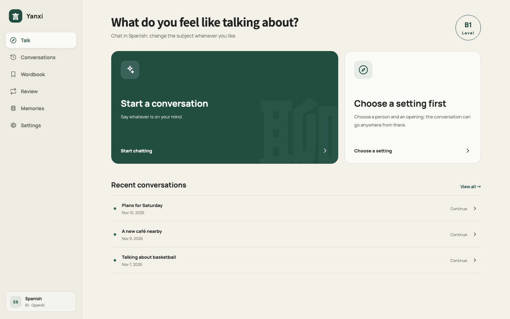
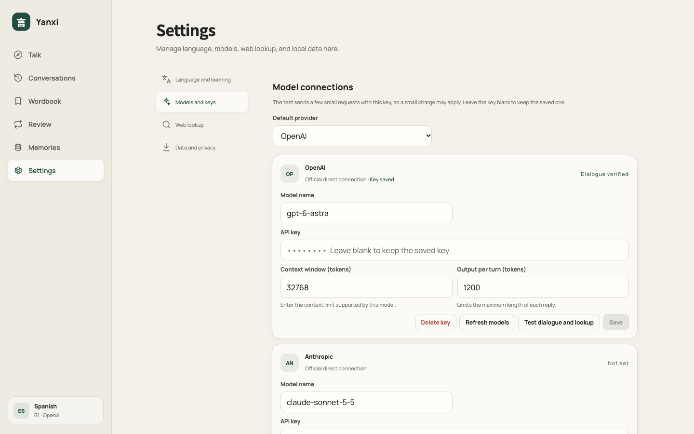
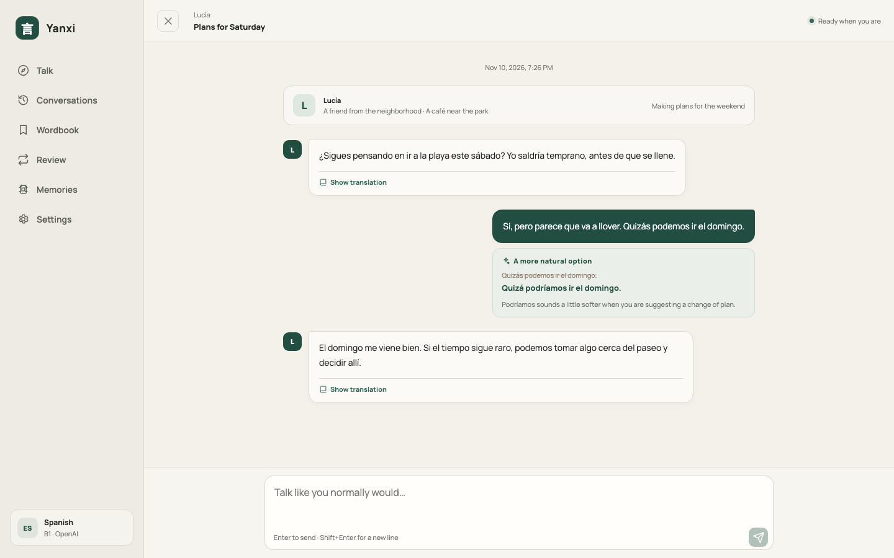
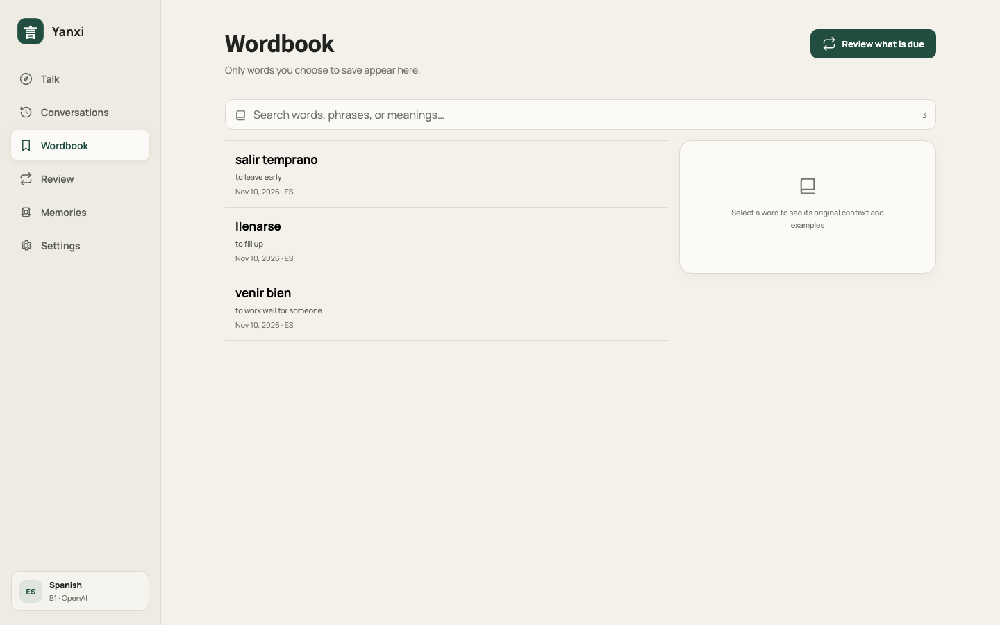

# Yanxi · Local Language Coach

English · [简体中文](./README.zh-CN.md)

Practice real conversations on your own computer, using a model provider you already have.

Yanxi does not turn every conversation into a lesson or an interview. Start talking right away, or choose a person and setting first. The conversation can change direction naturally, and your partner responds to what you actually said.

> **Keep Yanxi running at home and continue from your phone while you are out.** The built-in protected Quick Tunnel gives you a temporary address without renting a server, buying a domain, or creating a Cloudflare account.



## What you can do

- **Start talking immediately** — no lesson or task setup required.
- **Create a setting** — choose a person, place, and loose opening topic.
- **Get corrections without breaking the conversation** — suggestions stay below your message.
- **Look up words in context** — double-click, select, or long-press part of a reply.
- **Build a word list** — save only the words you want to keep and review them later.
- **Continue old conversations** — reopen any conversation and carry on where you left off.
- **Use it away from home without renting a server** — open a protected temporary address from your phone.
- **Search when current information matters** — optional and off by default.
- **Keep your data local** — conversations, settings, memories, and API keys stay on your computer.

## Requirements

You need:

- [Node.js](https://nodejs.org/) `22.13` or newer
- npm, which is included with Node.js
- An API key from OpenAI, Anthropic, Google Gemini, DeepSeek, or Moonshot/Kimi

You do not need Docker, a separate database, a global pnpm installation, a cloud server, or a domain.

> Model providers may charge for API usage. Yanxi does not collect those fees.

## Download and run

### Download the ZIP

1. Download the [latest source archive](https://github.com/yuanqishen666/local-language-coach/archive/refs/heads/main.zip).
2. Extract the archive.
3. Open a terminal in the extracted folder.
4. Run:

```bash
npm start
```

### Clone with Git

```bash
git clone https://github.com/yuanqishen666/local-language-coach.git
cd local-language-coach
npm start
```

The first start installs the required packages and builds the app. This usually takes one to three minutes. Your browser opens automatically when the app is ready.

If the browser does not open, use the local address printed in the terminal. The default is:

```text
http://127.0.0.1:4174
```

Keep the terminal open while using the app. Press `Ctrl+C` to stop it.

You can also use the launcher for your operating system:

| System | Launcher |
| --- | --- |
| macOS | `start-app.command` |
| Windows | `start-app.cmd` |
| Linux | `start-app.sh` |

## First-time setup

1. Choose the interface language, language you want to practise, and your current level.
2. Open **Settings → Models & keys**.
3. Choose a provider and model.
4. Enter the API key.
5. Test the connection, then save it.
6. Return to the home page and start a conversation.

The API key stays on your computer. It is not shown in conversations or diagnostic logs.



## Two ways to start

### Open conversation

Say whatever is on your mind. This works well for everyday conversation, expression practice, and topics that change as you talk.

### Conversation setting

Give the conversation a loose starting point, such as:

- Talking about weekend plans with a colleague
- Meeting someone at a café
- Discussing a basketball game with a local
- Asking about transport and weather while travelling

The setting starts the conversation; it does not lock you into a script.



## Word lookup and review

Double-click, select, or long-press unfamiliar text in your partner's message to look it up in context. A word enters your word list only when you save it.

The review page schedules practice from the words you have kept. Removing a word also removes its review schedule.



## Web search

Web search is off by default. Turn it on under **Settings → Web**.

When enabled, Yanxi searches only when a reply depends on current information, such as a team roster, recent event, opening status, weather, or current price. Everyday conversation and language corrections do not trigger a search.

If you share a URL, post, account, or platform location, Yanxi checks that location first. This permission applies only to the current turn.

## Supported providers

| Provider | Required key |
| --- | --- |
| OpenAI | OpenAI API key |
| Anthropic | Anthropic API key |
| Google Gemini | Google AI API key |
| DeepSeek | DeepSeek API key |
| Moonshot / Kimi | Moonshot API key |

Yanxi connects only to official provider APIs. A model must pass conversation, structured-response, and web-search checks before it can be saved as an available model.

The selected provider handles both the conversation and any search required for that turn. There is no separate background search model.

## Local data

Runtime data is stored in the project's `data/` folder:

```text
data/
├── app.db
├── config.json
├── secrets.json
└── logs/
```

- `app.db` stores conversations, saved words, reviews, and memories.
- `config.json` stores regular settings.
- `secrets.json` stores API keys.
- `logs/` contains redacted startup diagnostics.

Do not commit the `data/` folder to a public repository.

Yanxi includes no telemetry. Only the currently selected provider receives the content needed to generate the current reply.

## Use it from your phone — no server required

Yanxi normally accepts connections only from the computer running it. When you are away from home, its built-in protected Quick Tunnel can create a temporary HTTPS address for your phone. There is no server to rent and no Cloudflare account or domain to configure.

1. Start Yanxi on your computer and leave that terminal running:

```bash
npm start
```

2. Open a second terminal in the same folder:

```bash
npm run app -- remote start
```

3. Enter the email address allowed to connect. The first run prepares the tunnel program automatically.
4. Open the displayed `https://...trycloudflare.com` address on your phone.
5. Enter the allowed email address and the one-time code sent to that inbox.

Check the current address or close it with:

```bash
npm run app -- remote status
npm run app -- remote stop
```

This uses Cloudflare's [free Quick Tunnel](https://developers.cloudflare.com/tunnel/get-started/quick-tunnels/). The address changes whenever a new tunnel starts and has no uptime guarantee. Your computer, Yanxi, and the tunnel process must remain running. Remote traffic passes through Cloudflare, while the API keys and local database remain on your computer. Your model provider may still charge for model usage.

## Troubleshooting

### `node` or `npm` is not found

Install Node.js from [nodejs.org](https://nodejs.org/), then reopen the terminal.

### The app does not start

Run the full diagnostic check:

```bash
npm run doctor -- --verbose
```

The check does not call a model or print API keys.

### The browser does not open

Copy the local address shown in the terminal and open it manually.

### A model test fails

Check the API key, account balance, model name, and network connection. Keys from different providers are not interchangeable.

### Updating Yanxi

Pull or download the latest code, then run `npm start` again. The launcher checks the dependencies and rebuilds the app when needed. Existing practice data is kept.

## Current scope

- Text conversations only
- No speech recognition, pronunciation scoring, or live voice calls yet
- A supported provider API key is required
- Designed primarily for personal, local use

## Development

```bash
npm run dev
npm run typecheck
npm run build
```

Main directories:

```text
src/        Web interface
server/     Local service and provider adapters
shared/     Shared definitions
cli/        Command-line tools
tests/      Automated tests
```

## Contributing

Feature ideas and reproducible bugs are welcome in [GitHub Issues](https://github.com/yuanqishen666/local-language-coach/issues).

When reporting a problem, include your operating system, Node.js version, provider and model name, steps to reproduce, and relevant output from `npm run doctor -- --verbose`. Never include an API key.

## License

[MIT](./LICENSE)
