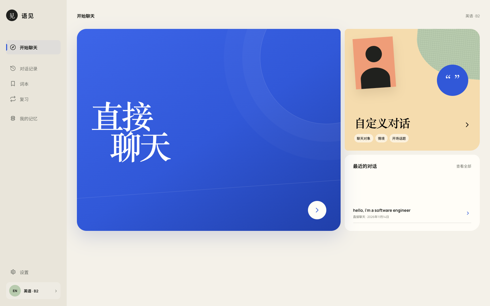
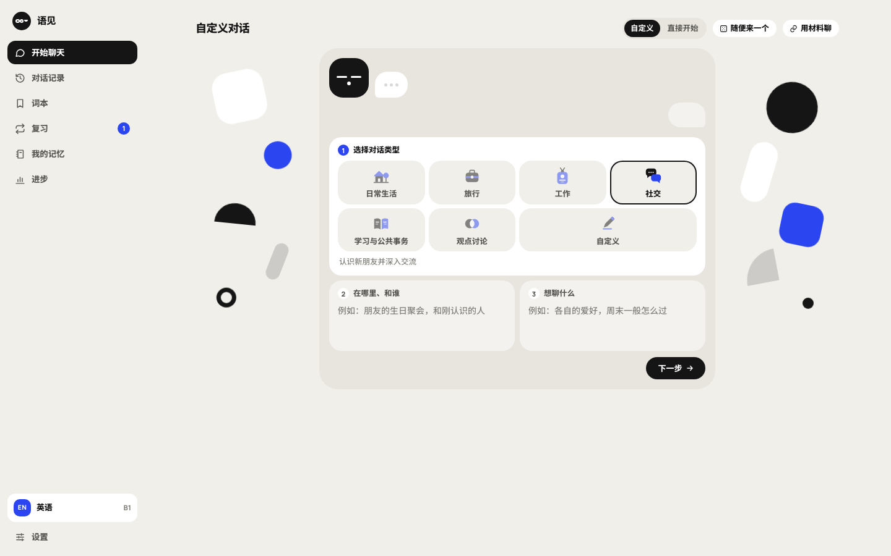
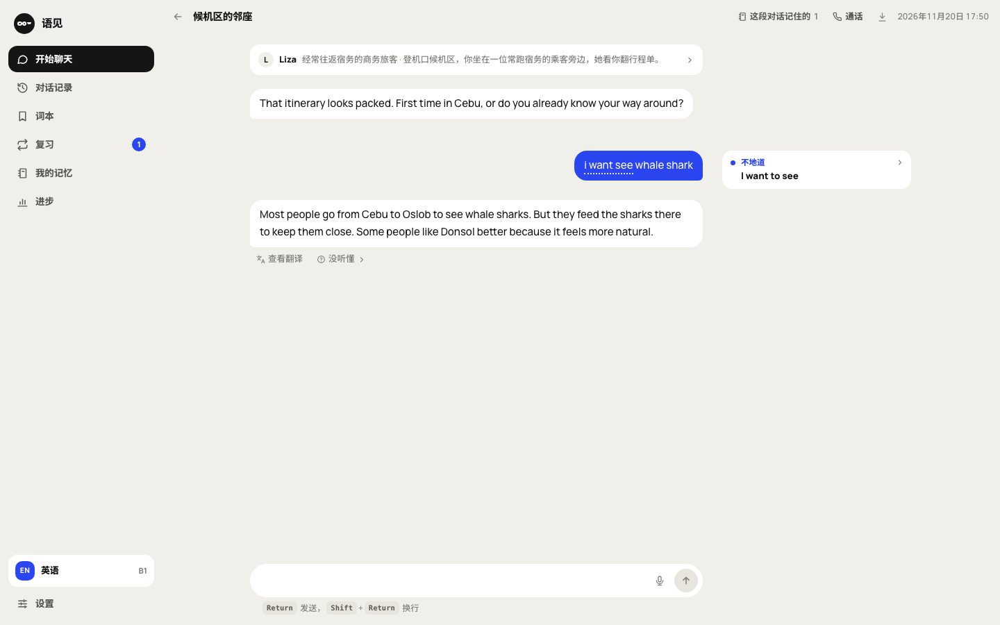

# 语见

[English](./README.md) · 简体中文

在自己的电脑上，用你选择的模型，练习能接住话题的真实对话。

直接说第一句话，或者先定一个对话背景。语见会先回应你刚刚说的内容，再在需要时给出纠错、释义和更自然的表达。你确认保存的信息，可以在以后的对话中继续使用。



## 可以做什么

- **直接聊天**：不选课程，不设任务，说第一句话就能开始。
- **自定义对话**：选择主题，填写情境或话题，再挑选聊天对象和开场；也可以随便来一个。
- **测水平，难度跟着你走**：约 10 题的水平测试定下起点；对方的回复不超出你的水平，你进步了再慢慢变难。
- **自然接话**：话题可以延续、切换或结束；拒绝过的问题不会被反复拉回来。
- **轻量纠错**：先完成对话，纠错和更自然的说法显示在你的消息下方。
- **没听懂可以说**：让对方说简单点，或者要一点提示，不用离开对话。
- **开口说**：语音输入、不用动手的通话、跟读、先听后看。
- **查词与翻译**：双击、选中或长按回复中的内容，按需查看词义和译文。
- **播放发音**：朗读对方回复、纠正后的表达、单词、语境和例句。
- **对话后复盘**：哪些说对了，哪些要改，再用自己的错题做一组小练习。
- **由你决定记住什么**：只有确认过的内容才会保存，并且可以随时修改、删除或设为核心记忆。
- **词本与复习**：按遗忘规律安排复习，到期的词会回到后面的对话里，还能用收藏的词写成短故事，并导出到 Anki。
- **带自己的材料来聊**：贴一段文字或一个链接，读完就着它聊。
- **看得见的进步**：哪些天练了、水平怎么变的、这一周的小结。
- **和真人练习前做准备**：上课或见语伴之前拿一张“这次想练的三件事”，练完再复盘。
- **花了多少钱心里有数**：每段对话和每个月的估算花费，可以设每月提醒金额。
- **一台电脑多人用**：每个学习档案有自己的对话、词本和记忆。
- **继续以前的对话**：历史对话可以随时打开，不需要重新开始。
- **按需联网**：需要最新信息时可以使用当前模型的搜索能力，默认关闭。
- **数据留在本机**：对话、词本、复习、记忆、设置和 API Key 都保存在当前电脑上。

## 支持的语言

语见支持练习以下 10 种语言：

- 英语
- 西班牙语
- 法语
- 日语
- 德语
- 韩语
- 意大利语
- 中文
- 葡萄牙语
- 印地语

界面同样支持 10 种语言：

- 简体中文
- 英语
- 拉丁美洲西班牙语
- 法语
- 日语
- 德语
- 韩语
- 意大利语
- 巴西葡萄牙语
- 印地语

界面语言与学习语言可以分别设置。对话使用学习语言；纠错说明、词义、翻译和记忆内容使用当前界面语言。

## 使用 AI 助手安装

如果你使用的 AI 助手能够操作当前电脑的文件、终端和浏览器，可以把下面整段发送给它：

```text
请直接在我的电脑上安装并启动“语见”，不要只给我操作步骤。官方仓库是 https://github.com/yuanqishen666/local-language-coach 。请把项目下载到一个由当前用户管理、适合长期保留并且以后容易找到的本地目录；优先使用 Git 克隆仓库，如果电脑没有 Git，也可以直接下载官方仓库 main 分支的 ZIP 并解压，不要因此停止安装。检查 Node.js 是否满足项目要求，不满足时从 Node.js 官方来源安装符合要求的版本。然后进入项目目录运行 npm start，在可以持续运行的终端中保持应用运行，等待启动成功，并在浏览器中打开它的本地网页。如果启动失败，请运行 npm run doctor -- --verbose，并根据诊断结果继续排查。如果发现已有安装，必须保留 data/ 目录，不得删除、覆盖、上传或读取其中的 API Key、对话和设置。网页成功打开后即视为安装完成；不要配置 API Key、模型或其他产品设置，也不要向我索取 API Key。最后请用普通用户能看懂的方式告诉我：语见是否已经安装并成功打开、项目安装位置、本次访问地址，以及以后如何再次打开和停止它。再次打开时，macOS 使用 start-app.command，Windows 使用 start-app.cmd，Linux 使用 start-app.sh；只介绍当前操作系统对应的方法，并说明使用时需要保持启动窗口运行，关闭窗口或按 Ctrl+C 会停止语见。如果浏览器没有自动打开，也请告诉我从启动窗口哪里找到本地访问地址。不要让我以后重新克隆仓库、重新安装依赖，也不要只告诉我运行 npm start。
```

AI 助手只负责下载项目、准备运行环境、启动应用并打开网页。API Key、模型和其他设置请在语见网页中自行完成。安装结束时，AI 助手会告诉你项目保存在哪里，以及下次需要使用哪个启动文件。

## 运行要求

开始前需要：

- [Node.js](https://nodejs.org/) `22.13` 或更高版本（用下面的一行安装时，电脑上没有会自动准备一份）
- npm，安装 Node.js 时会一并安装
- OpenAI、Anthropic、Google Gemini、DeepSeek 或 Moonshot/Kimi 中任意一家的 API Key，或者一个 OpenAI 兼容服务的地址

不需要安装 Docker、SQLite 或全局 pnpm，也不用购买云服务器和域名。

> 模型厂商可能按调用量收费。语见本身不会代收模型费用。

## 下载与启动

### 一行安装

macOS 和 Linux：

```bash
curl -fsSL https://raw.githubusercontent.com/yuanqishen666/local-language-coach/main/scripts/install.sh | sh
```

Windows（PowerShell）：

```powershell
irm https://raw.githubusercontent.com/yuanqishen666/local-language-coach/main/scripts/install.ps1 | iex
```

中国大陆网络访问 GitHub 或 Node.js 官网较慢时，改用下面的大陆网络备用命令。

macOS 和 Linux：

```bash
curl -fsSL https://gh-proxy.com/https://raw.githubusercontent.com/yuanqishen666/local-language-coach/main/scripts/install.sh | YUJIAN_GITHUB_MIRROR=https://gh-proxy.com YUJIAN_NODE_MIRROR=https://npmmirror.com/mirrors/node npm_config_registry=https://registry.npmmirror.com sh
```

Windows（PowerShell）：

```powershell
$env:YUJIAN_GITHUB_MIRROR='https://gh-proxy.com'; $env:YUJIAN_NODE_MIRROR='https://npmmirror.com/mirrors/node'; $env:npm_config_registry='https://registry.npmmirror.com'; irm 'https://gh-proxy.com/https://raw.githubusercontent.com/yuanqishen666/local-language-coach/main/scripts/install.ps1' | iex
```

安装脚本把语见下载到用户目录下的 `yujian` 文件夹并启动。电脑上没有 Node.js `22.13` 或更高版本时，它会把官方的 Node.js 下载到这个文件夹里的 `.runtime/node`，并校验 SHA-256；不会往系统里安装任何东西。再运行一次同样的命令就是更新，`data/` 目录不会被动到。

| 环境变量 | 作用 |
| --- | --- |
| `YUJIAN_DIR` | 装到别的文件夹 |
| `YUJIAN_NO_START=1` | 只安装，不启动 |
| `YUJIAN_GITHUB_MIRROR` | 通过 GitHub 公益代理下载公开仓库，例如 `https://gh-proxy.com` |
| `YUJIAN_NODE_MIRROR` | 从 `https://nodejs.org/dist` 的镜像下载 Node.js，例如 `https://npmmirror.com/mirrors/node` |

大陆网络备用命令使用第三方公益代理 `gh-proxy.com` 和 npmmirror；它们不由本项目或 GitHub 运营，可能会失效。GitHub 公益代理只用于本项目这样的公开仓库，不要用它下载私有仓库，也不要在地址里放 Token。两条命令都失败时，可以用别的办法拿到 ZIP，解压到 `yujian` 文件夹，再运行一次命令：这时脚本只准备 Node.js 并启动应用。

### 下载 ZIP

1. 下载[最新源码压缩包](https://github.com/yuanqishen666/local-language-coach/archive/refs/heads/main.zip)。
2. 解压文件。
3. 在解压后的目录中打开终端。
4. 运行：

```bash
npm start
```

### 使用 Git

```bash
git clone https://github.com/yuanqishen666/local-language-coach.git
cd local-language-coach
npm start
```

第一次启动会自动安装依赖并构建应用，通常需要一到三分钟。完成后浏览器会自动打开。

如果浏览器没有打开，终端里会显示本地访问地址。默认地址是：

```text
http://127.0.0.1:4174
```

使用时请保持终端运行。按 `Ctrl+C` 可以停止应用。

也可以使用系统对应的启动文件：

| 系统 | 启动文件 |
| --- | --- |
| macOS | `start-app.command` |
| Windows | `start-app.cmd` |
| Linux | `start-app.sh` |

## 第一次使用

1. 选择界面语言和想练习的语言，然后做水平测试，或者自己选一个程度。

2. 打开 **设置 → 模型与密钥**。
3. 选择模型厂商和模型。
4. 填写 API Key。
5. 点击测试，测试通过后保存。
6. 回到首页，选择直接聊天或自定义对话。

API Key 只保存在本机，不会显示在对话页面或诊断日志中。


## 两种开始方式

### 直接聊天

点击首页的“直接聊天”，说第一句话即可开始。没有预设任务，话题也不需要沿着固定流程发展。

### 自定义对话

选择一个主题，也可以补充具体情境或想聊的话题。语见会生成可选的聊天对象和开场方式。

这些内容只决定如何开始，不会限制之后聊什么。



## 对话、纠错与记忆

回复会先接住当前话题。需要纠正时，修改建议显示在你的消息下方，不会把整段聊天变成讲解。

对话中识别到值得长期保留的信息时，语见会先询问是否保存。未经确认的内容不会进入记忆。已保存的内容可以在“我的记忆”中查看、修改、删除或调整优先级。




## 水平与难度

水平测试约 10 题，会根据你的回答调整：阅读、听力，还有几道用自己的话写的题。拿不准可以选“不确定”。也可以跳过测试，自己在 A1 到 C2 之间选；以后随时可以重测。

对话时，对方的回复会控制在你的水平以内：显示之前会按词频表检查句子长度和生词比例。你跟得轻松，难度就上调一小步；吃力了就放缓。一段对话开始时如果比上次难，顶部会有一行说明。

每种学习语言各有各的水平。

## 语音

- **语音输入**：点麦克风，把要发的话说出来。
- **通话**：不用动手的一来一回。你说完，对方的回复朗读出来，然后麦克风再次打开。
- **跟读**：听一句，跟着说一遍，看哪些词说得不一样。
- **先听后看**：回复先朗读、文字先藏起来，要看时再显示。可以再听一遍、放慢、按句听。

语音识别默认由浏览器完成，不另收费。请用下面的浏览器打开语见：

| 系统 | 能用语音输入的浏览器 |
| --- | --- |
| Windows、Linux、Android | Chrome |
| macOS | Chrome 或 Safari |
| iPhone、iPad | Safari，要直接打开，不能从主屏幕图标或其他应用里打开 |

- Chrome 会把声音发给谷歌的语音服务，Safari 发给苹果。Safari 需要先打开 Siri 或听写。
- Firefox 的大多数版本没有语音识别；Opera 有这个接口但不出结果；Microsoft Edge 的说法不一。
- 当前浏览器用不了时，语见会说明原因，并告诉你换哪个浏览器打开。不用重装或重启，把本地地址复制到那个浏览器即可。
- 已配置的模型来自 OpenAI 或 Google Gemini 时，可以改为把录音发给模型转成文字：**设置 → 语言与学习 → 语音输入 → 已配置的模型**。这部分由厂商按语音价格另外计费。其他厂商的模型不能接收录音。
- 麦克风只在 `localhost` 或 `https` 下可用。其他设备通过局域网的 `http` 地址打开语见时用不了麦克风。

上表依据 2026 年 11 月的浏览器公开文档整理，没有在每个系统和浏览器版本上逐一试过。

## 复盘与小练

聊满三轮以后，点**复盘**可以看这段对话的小结：哪些说对了，哪些纠错值得记下，用上了哪些收藏的词。从复盘里可以开始一组用自己的错题出的小练习。复盘只在你点的时候才生成。

## 查词、词本与复习

对方说了不熟悉的词时，双击、选中或长按对应内容即可查看解释。只有主动收藏的词才会进入词本。

复习用 FSRS 安排，每个评分按钮上写着这个词下次什么时候再出现。到期的词也会出现在接下来的对话里，用对了就算复习过一次；只想用卡片复习的话，可以在设置里关掉。删除词汇后，对应的复习计划也会一起移除。

词本里还可以：

- 读一篇用收藏的词写成的短故事，再就着故事聊；
- 贴一段文字或一个链接，边读边查词，然后就着它开始对话；
- 把词本导出成 Anki 可以导入的文件。

首页可以根据最近的错误和到期的词，建议接下来练什么。

## 进步

**进步**页显示最近 26 周哪些天练了、水平怎么变的，以及这一周和上一周的对比：对话数、消息数、写了多少词、第一次用上的收藏词、哪类错误犯得少了。

**睡前 5 分钟**会开始一段简短、不赶时间的对话，聊聊今天。

## 和真人练习

上课或见语伴之前，**和真人练习**给你一张卡片，写着这次想练的三件事：犯得最多的那类错误、等着用上的收藏词、上次没说出来的句子。卡片直接从你的学习记录里取，不调用模型。

练完以后，记下用上了什么、卡在哪里、对方纠正了什么，语见会整理成一份简短的复盘，以后可以回来看。

## 地区变体与语气

在**设置 → 语言与学习**里可以选地区变体：英语（美国、英国、澳大利亚）、西班牙语（拉丁美洲、西班牙、墨西哥、阿根廷）、法语（法国、加拿大）、德语（德国、奥地利、瑞士）、葡萄牙语（巴西、葡萄牙）、中文（大陆、台湾），也可以选对方说话的语气：中性、随意或正式。浏览器有对应声音时，朗读和语音输入会跟着所选的变体。

两种说法都可以，或者模型拿不准的时候，纠错会照实标出来，不计入错误。

## 发音播放

当浏览器为当前学习语言提供适合学习的朗读声音时，对话回复、纠正后的目标语言表达、查词结果、词本和复习答案旁会显示发音按钮。语见使用当前浏览器提供的 [Web Speech API](https://developer.mozilla.org/en-US/docs/Web/API/Window/speechSynthesis) 播放声音，不会为发音调用模型，也不会消耗模型额度。

语见会优先选择浏览器的 Natural、Neural、Premium、Enhanced 或 Google 音色，其次使用经过筛选的常规系统声音；`Albert`、`Bad News` 等效果音不会用于语言学习。如果浏览器找不到适合当前学习语言的声音，发音按钮会自动隐藏。是否显示取决于浏览器实际提供的声音，而不只取决于浏览器名称。

默认发音语速为适合学习的 `0.85×`。可以在 **设置 → 语言与学习 → 朗读与语速** 中调整为 `0.60×–1.20×`；保存后会应用到所有发音播放。如果浏览器找不到适合当前学习语言的声音，语速滑块不会显示，设置页会说明原因并推荐更合适的浏览器。

不同系统和浏览器提供的声音数量、口音与自然程度可能不同。建议使用最新稳定版浏览器：

| 系统 | 推荐浏览器 |
| --- | --- |
| Windows | Microsoft Edge；通常能更完整地使用 Windows 语音和自然音色 |
| macOS | 优先使用 Safari 调用系统声音；希望使用更丰富的自然音色时可尝试 Microsoft Edge |
| Linux | Firefox，并确保系统已安装和启用 Speech Dispatcher 及对应语言的语音引擎 |

Microsoft Edge 可能提供联网音色。使用这类声音时，朗读文字可能由浏览器的在线语音服务处理；这是浏览器功能，不经过语见的模型接口。希望完全离线时，请在浏览器或系统中选择已安装的本地声音。

如果启动后自动打开的不是推荐浏览器，请从启动窗口复制本地地址（默认是 `http://127.0.0.1:4174`），再粘贴到推荐浏览器中打开，不需要重新安装或重新启动语见。

如果看不到发音按钮，说明当前浏览器没有为该学习语言提供语见认可的音色，请安装对应语言的系统声音或更换推荐浏览器。如果按钮可见但没有声音，请检查系统音量和浏览器的自动播放权限。Linux 发行版以及 Flatpak、Snap 安装的浏览器可能无法直接访问系统语音；此时需要先正确配置 Speech Dispatcher。发音播放不包含发音评分。

## 联网搜索

联网搜索默认关闭，可以在 **设置 → 联网** 中开启。

开启后，语见只会在内容明显依赖最新信息时搜索，例如球队阵容、近期赛事、营业状态、天气或当前价格。普通聊天、语言纠正和角色对话不会为了搜索而搜索。

如果你发来一个网址、帖子或平台位置，语见会优先查看你给出的地方。这个授权只对当前一轮有效。

## 支持的模型厂商

| 厂商 | API Key |
| --- | --- |
| OpenAI | OpenAI API Key |
| Anthropic | Anthropic API Key |
| Google Gemini | Google AI API Key |
| DeepSeek | DeepSeek API Key |
| Moonshot / Kimi | Moonshot API Key |
| 自定义 OpenAI 兼容地址 | 按那个服务的要求填 |

内置的厂商都使用官方接口。一个模型必须通过多轮对话、结构化回复和联网能力测试后才能保存为可用模型。

自定义地址可以接任何兼容 OpenAI 对话接口的服务，例如通义千问、智谱、豆包，或者用 Ollama、LM Studio 在自己电脑上运行的模型。在**设置 → 模型与密钥**里填地址和模型名。它同样要通过多轮对话和结构化回复测试；没有联网搜索；即使服务不检查 Key，Key 一栏也要填点内容。

当前选择的模型负责对话和本轮需要的搜索。语见不会另外调用一家模型充当后台搜索服务。

可以另选一个模型用来写复盘、出练习和给水平测试评分，对话本身用快而便宜的那个。

## 花费

**设置 → 花费**显示这个月的估算花费，按用途和模型分开，旁边是上个月的数。复盘和水平测试结果里也会写这段对话或这次测试花了多少。

- 这些数字是按 token 数和公开标价（美元，取自 LiteLLM 的价格表，2026-11-20）算出来的估算，不含缓存折扣、长上下文加价和按次收取的搜索费。实际金额以厂商账单为准。
- 价格表里没有的模型，或者你的价格不一样，可以自己填每百万 token 的价格。
- 可以设每月提醒金额，估算超过时提醒你；不会拦住任何操作。
- 用量按整个安装统计，所有学习档案合在一起。

## 本地数据

运行后产生的数据保存在项目的 `data/` 目录：

```text
data/
├── app.db
├── profile-<id>.db
├── usage.db
├── config.json
├── secrets.json
├── setup-signing-key
└── logs/
```

- `app.db` 保存对话、词本、复习记录和记忆。
- `profile-<id>.db` 保存每个新增学习档案的同类数据。
- `usage.db` 保存 token 用量和估算花费。
- `config.json` 保存普通设置。
- `secrets.json` 保存 API Key。
- `setup-signing-key` 用于验证短时有效的本地模型测试凭证，不包含厂商 API Key。
- `logs/` 保存经过脱敏的启动诊断信息。

不要把 `data/` 上传到公开仓库。

应用没有遥测。只有当前选择的模型厂商会收到生成本轮回复所需的内容。

### 学习档案

在**设置 → 数据与隐私 → 学习档案**里，一次安装最多可以加 12 个学习者。每个人有自己的对话、词本、记忆、水平和语言设置；模型、Key 和用量统计是共用的。切换时应用会重新加载。

### 导出与导入

- **备份**：把当前档案的数据下载成一个文件。
- **记忆**：可以导出，也可以再导入到这次或另一次安装里。
- **对话**可以存成 Markdown，**词本**可以存成 Anki 用的文件。两者都在浏览器里生成。

## 外出用手机访问，不用买服务器

语见平时只允许当前电脑访问。外出时，可以通过内置的受保护临时通道生成一个 HTTPS 地址，在手机上继续使用。不用租服务器，也不用配置域名或注册 Cloudflare 账号。

1. 在电脑上启动语见，并保持这个终端运行：

```bash
npm start
```

2. 在同一项目目录打开另一个终端：

```bash
npm run app -- remote start
```

3. 按照提示填写允许访问的邮箱。第一次开启时会自动准备通道程序。
4. 在手机上打开终端显示的 `https://...trycloudflare.com` 地址。
5. 填写允许访问的邮箱，再输入邮件里收到的一次性验证码。

查看当前地址或关闭通道：

```bash
npm run app -- remote status
npm run app -- remote stop
```

这里使用 Cloudflare 提供的[免费 Quick Tunnel](https://developers.cloudflare.com/tunnel/get-started/quick-tunnels/)。每次重新开启都会生成不同的临时地址，也不保证持续在线。电脑、语见和通道进程都要保持运行。远程访问流量会经过 Cloudflare，但 API Key 和本地数据库仍保存在你的电脑上；模型调用仍可能由模型厂商收费。

### 在同一个 Wi-Fi 下

在家里，同一网络下的手机或平板可以不经过通道直接打开语见：

1. 打开**设置 → 数据与隐私 → 局域网访问**，然后停掉语见再启动一次。
2. 在另一台设备上打开那里显示的地址。
3. 输入旁边显示的访问码。换一个访问码会让用旧码进来的设备退出。

这条连接是局域网内的明文 `http`，浏览器不允许另一台设备使用麦克风；要在那台设备上用语音，请用上面的通道。系统防火墙可能会问是否允许传入连接。

## 常见问题

### `node` 或 `npm` 命令不存在

从 [Node.js 官网](https://nodejs.org/)安装 Node.js，完成后重新打开终端。

### 启动失败

运行完整检查：

```bash
npm run doctor -- --verbose
```

诊断不会发送模型请求，也不会输出 API Key。

### 浏览器没有自动打开

查看终端中显示的本地地址，并手动复制到浏览器。

### 模型测试失败

检查 API Key、账户余额、模型名称和当前网络。不同厂商的 Key 不能混用。

### 如何更新

获取最新代码后重新运行 `npm start`。启动程序会重新检查依赖和构建结果，不会删除已有练习数据。

## 当前范围

- 支持文字和语音对话；朗读由浏览器完成，语音识别默认也由浏览器完成。
- 不包含音素级的发音评分。
- 必须自行准备厂商的 API Key，或一个 OpenAI 兼容的地址。
- 项目主要面向个人、本地使用。

## 开发

```bash
npm run dev
npm run typecheck
npm run build
```

主要目录：

```text
src/        网页界面
server/     本地服务与模型适配
shared/     前后端共用定义
cli/        命令行工具
tests/      自动化测试
```

## 参与项目

功能建议和可以稳定复现的问题，欢迎提交到 [GitHub Issues](https://github.com/yuanqishen666/local-language-coach/issues)。

报告问题时，请附上操作系统、Node.js 版本、模型厂商和模型名称、复现步骤，以及 `npm run doctor -- --verbose` 的相关输出。不要附上 API Key。

## 使用许可

本项目[不可商用](./LICENSE)。如需商用，请联系作者并获得授权。
