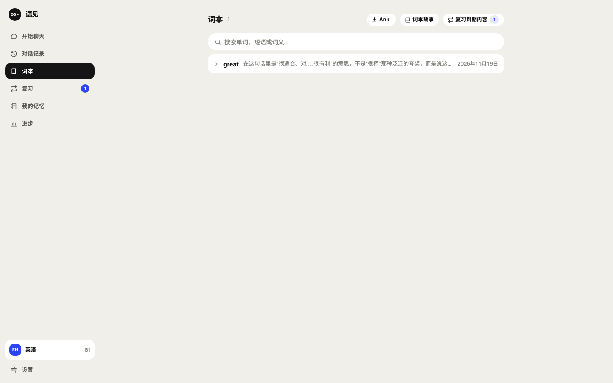
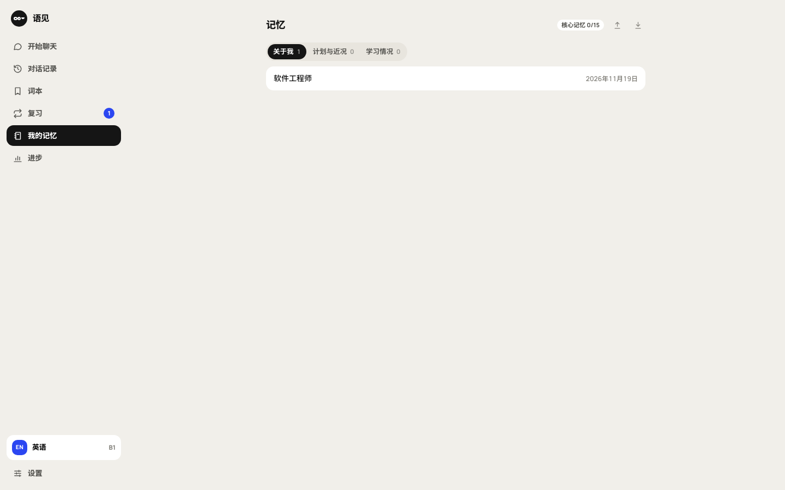
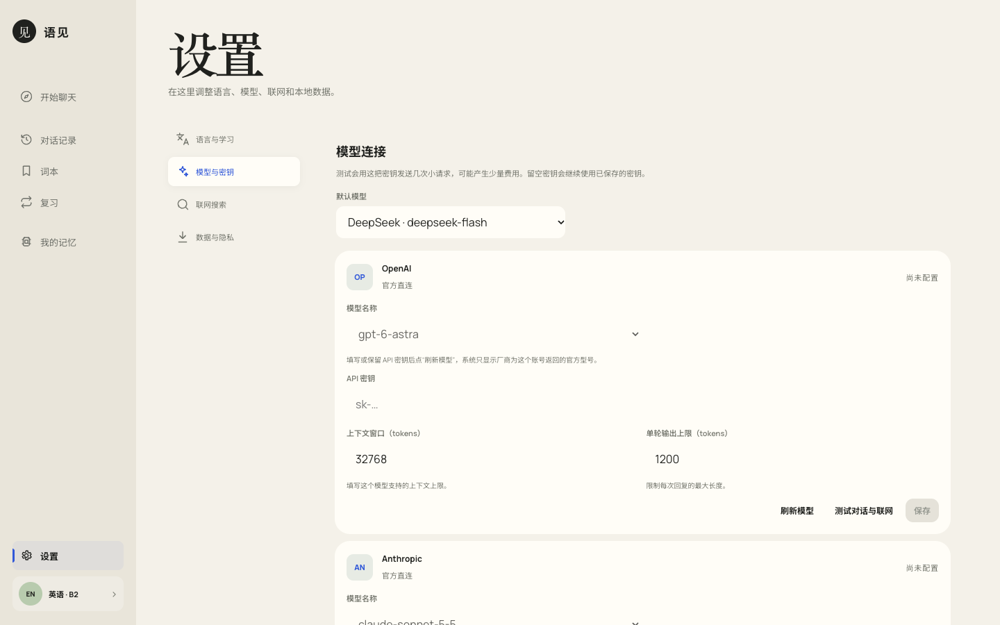

# 语见

[English](./README.md) · 简体中文

在自己的电脑上，用你选择的模型练习一门语言。从一句话开始，让对话、纠错、词本、复习和记忆自然连成一条学习路径。


## 把注意力放在表达上

- **先把话聊下去**：回复会接住当前话题，纠错不会抢走对话。
- **难度跟着你变化**：水平测试给出起点，之后根据实际表现逐步调整。
- **每次练习都有积累**：生词、常见错误、复盘和进步记录会回到后面的学习中。
- **记住什么由你决定**：只有确认过的内容才会进入长期记忆。
- **模型和数据都由你掌控**：选择自己的模型服务，学习记录和 API Key 保存在本机。

## 直接聊，也可以先设定场景

想说什么就说什么，适合日常开口和自由表达。需要更具体的情境时，可以选择日常、旅行、工作、社交等主题，再补充聊天对象、情境和开场话题。

场景只决定对话从哪里开始，不会把后面的交流限制在固定脚本里。


## 纠错不打断对话

语见先回应你表达的内容，再把需要调整的地方放在消息旁边。你可以看到更自然的说法、修改原因，也能随时查看回复的翻译。

遇到不熟悉的内容时，选中、双击或长按即可查词；听不懂时，也可以让聊天对象说得简单一点或给出提示。


## 把遇到的词变成自己的词本

只有主动收藏的词才会进入词本。每个词都会保留当时的语境、含义和例句，并按照记忆情况安排复习。

收藏的词还能重新出现在后续对话里，也可以用来生成短故事、展开新对话，或导出到 Anki。



## 只记住你同意保存的内容

值得在以后继续使用的信息，会先询问你是否保存。记忆分为核心记忆、个人偏好、学习情况和对话经历，可以随时修改、删除或调整优先级。



## 从对话到复习

- **水平测试**：通过阅读、听力和简短表达确定 A1–C2 起点，也可以直接选择水平。
- **动态难度**：回复长度和用词会根据当前水平调整，每种学习语言分别记录。
- **对话复盘**：总结表达亮点、值得保留的纠错和已经用上的收藏词。
- **针对性小练**：用自己的错误和卡住的表达生成练习。
- **进步记录**：查看练习天数、消息与词数、水平变化和每周对比。
- **睡前 5 分钟**：用一段简短、放松的对话回顾当天。

## 用声音练习

- **语音输入**：直接说出想发送的内容。
- **通话模式**：说完后自动朗读回复，再继续下一轮。
- **跟读**：听一句、跟一句，对照没有说准的词。
- **先听后看**：先听回复，再按需显示文字，也可以慢速或逐句播放。
- **发音播放**：在浏览器提供合适音色时，播放回复、纠错、单词和例句。

## 选择自己的模型

语见支持 OpenAI、Anthropic、Google Gemini、DeepSeek、Moonshot / Kimi，也可以连接兼容 OpenAI 接口的服务或本地模型。

对话模型和复盘模型可以分别选择。连接会在保存前完成测试，API Key 只保存在当前电脑上。



## 更多功能

- 保留完整对话记录，随时继续以前的话题。
- 粘贴一段文字或链接，边读边查词，再围绕内容对话。
- 按需开启联网搜索，处理天气、赛事、价格等需要最新信息的话题。
- 查看每段对话和每月的模型费用估算。
- 一台电脑可建立多个学习档案，彼此分开保存。
- 支持备份、记忆迁移、对话导出和 Anki 导出。
- 可以在同一 Wi-Fi 下使用手机，也可以临时开启受保护的远程访问。

## 支持的语言

可练习：英语、西班牙语、法语、日语、德语、韩语、意大利语、中文、葡萄牙语、印地语。

界面支持：简体中文、英语、拉丁美洲西班牙语、法语、日语、德语、韩语、意大利语、巴西葡萄牙语、印地语。

界面语言和学习语言可以分别设置。纠错说明、词义、翻译和记忆内容使用当前界面语言。

## 安装

需要准备一个受支持模型服务的 API Key。安装命令会自动准备运行环境并在完成后打开浏览器。

macOS 和 Linux：

```bash
curl -fsSL https://raw.githubusercontent.com/yuanqishen666/local-language-coach/main/scripts/install.sh | sh
```

Windows（PowerShell）：

```powershell
irm https://raw.githubusercontent.com/yuanqishen666/local-language-coach/main/scripts/install.ps1 | iex
```

### 中国大陆网络备用命令

GitHub 或 Node.js 官网访问较慢时，可以使用下面的镜像命令。

macOS 和 Linux：

```bash
curl -fsSL https://gh-proxy.com/https://raw.githubusercontent.com/yuanqishen666/local-language-coach/main/scripts/install.sh | YUJIAN_GITHUB_MIRROR=https://gh-proxy.com YUJIAN_NODE_MIRROR=https://npmmirror.com/mirrors/node npm_config_registry=https://registry.npmmirror.com sh
```

Windows（PowerShell）：

```powershell
$env:YUJIAN_GITHUB_MIRROR='https://gh-proxy.com'; $env:YUJIAN_NODE_MIRROR='https://npmmirror.com/mirrors/node'; $env:npm_config_registry='https://registry.npmmirror.com'; irm 'https://gh-proxy.com/https://raw.githubusercontent.com/yuanqishen666/local-language-coach/main/scripts/install.ps1' | iex
```

备用命令使用第三方公益代理 `gh-proxy.com` 和 npmmirror，可能会因服务状态变化而暂时不可用。公益代理只适合这个公开仓库，请勿通过它传递私有仓库地址或访问令牌。

也可以直接下载[最新源码压缩包](https://github.com/yuanqishen666/local-language-coach/archive/refs/heads/main.zip)，解压后在文件夹中运行 `npm start`。

重新运行同一条安装命令即可更新，已有学习数据会保留。打开语见后，选择界面语言和学习语言，完成水平设置，再到“设置 → 模型与密钥”填写自己的模型信息。

## 隐私

对话、词本、复习、记忆、设置和 API Key 保存在当前电脑上。语见没有遥测；只有你选择的模型服务会收到生成当前回复所需的内容。

学习数据可以随时备份。多人共用一台电脑时，每个学习档案的对话、词本、记忆和水平记录彼此独立。

## 反馈

功能建议和使用中遇到的问题可以提交到 [GitHub Issues](https://github.com/yuanqishen666/local-language-coach/issues)。请勿在公开内容中附上 API Key。

## 使用许可

本项目[不可商用](./LICENSE)。如需商用，请联系作者并获得授权。
