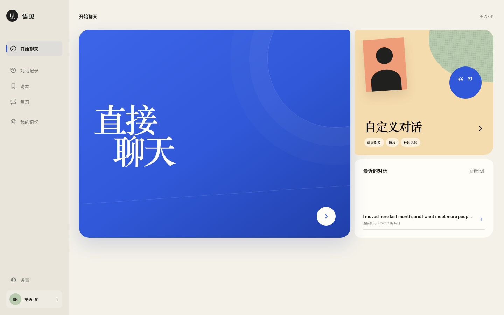
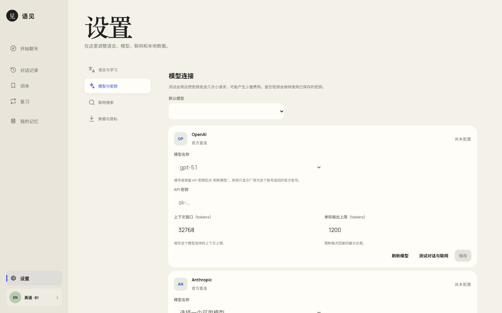
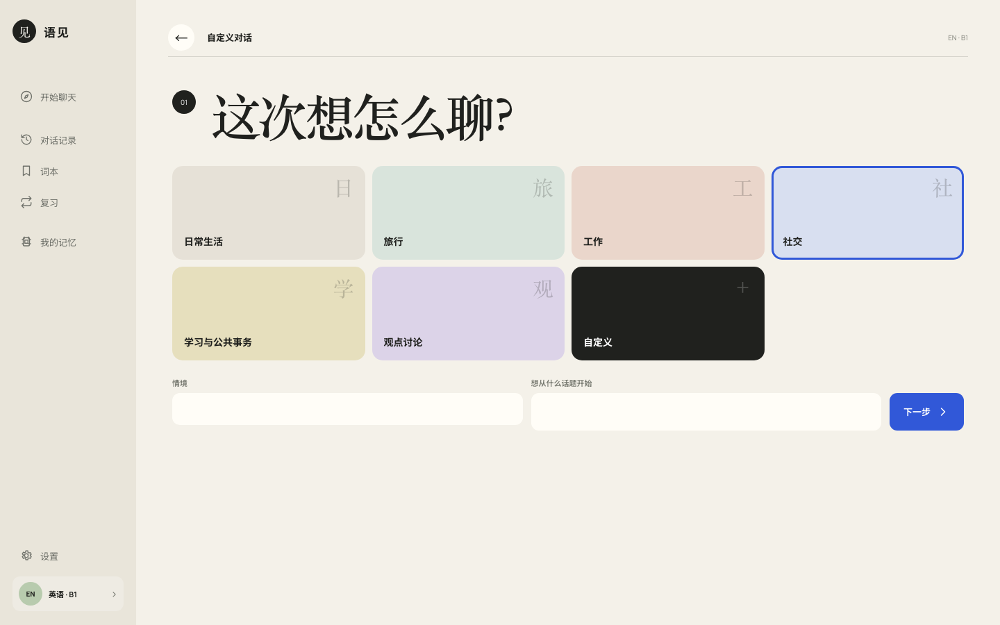
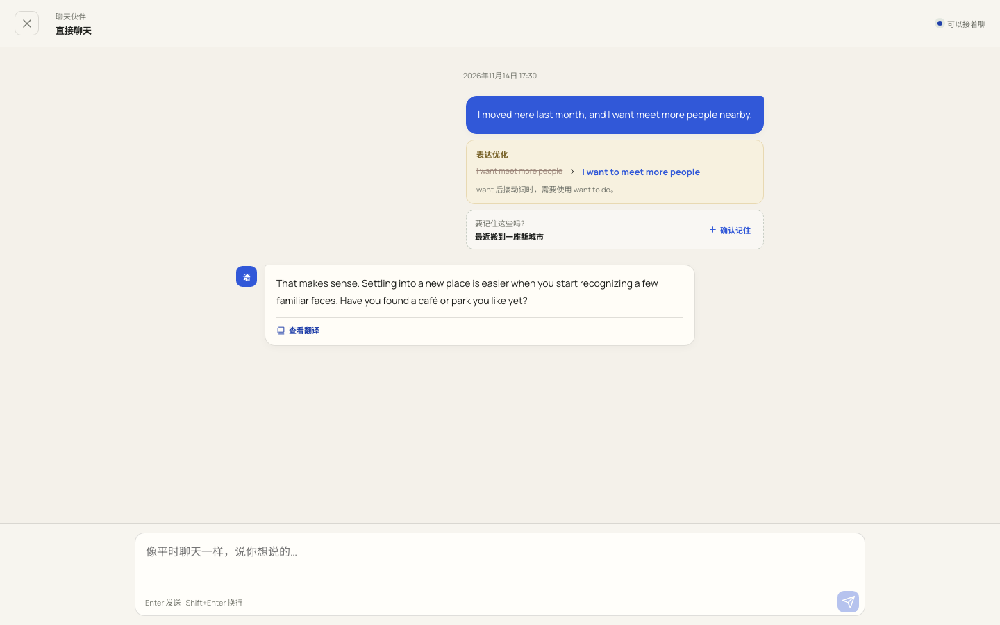
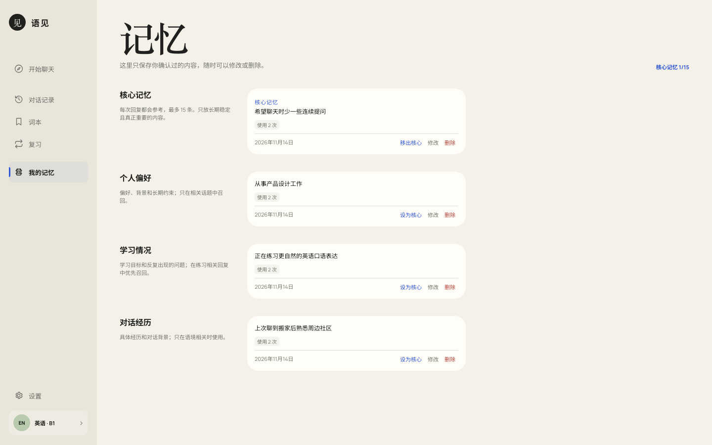

# 语见

[English](./README.md) · 简体中文

在自己的电脑上，用你选择的模型，练习能接住话题的真实对话。

直接说第一句话，或者先定一个对话背景。语见会先回应你刚刚说的内容，再在需要时给出纠错、释义和更自然的表达。你确认保存的信息，可以在以后的对话中继续使用。



## 可以做什么

- **直接聊天**：不选课程，不设任务，说第一句话就能开始。
- **自定义对话**：选择主题，填写情境或话题，再挑选聊天对象和开场。
- **自然接话**：话题可以延续、切换或结束；拒绝过的问题不会被反复拉回来。
- **轻量纠错**：先完成对话，纠错和更自然的说法显示在你的消息下方。
- **查词与翻译**：双击、选中或长按回复中的内容，按需查看词义和译文。
- **由你决定记住什么**：只有确认过的内容才会保存，并且可以随时修改、删除或设为核心记忆。
- **词本与复习**：收藏真正想记住的表达，再按学习记录安排复习。
- **继续以前的对话**：历史对话可以随时打开，不需要重新开始。
- **按需联网**：需要最新信息时可以使用当前模型的搜索能力，默认关闭。
- **数据留在本机**：对话、词本、复习、记忆、设置和 API Key 都保存在当前电脑上。

## 支持的语言

语见支持练习以下 10 种语言：

- 英语
- 西班牙语
- 法语
- 日语
- 德语
- 韩语
- 意大利语
- 中文
- 葡萄牙语
- 印地语

界面同样支持 10 种语言：

- 简体中文
- 英语
- 拉丁美洲西班牙语
- 法语
- 日语
- 德语
- 韩语
- 意大利语
- 巴西葡萄牙语
- 印地语

界面语言与学习语言可以分别设置。对话使用学习语言；纠错说明、词义、翻译和记忆内容使用当前界面语言。

## 运行要求

开始前需要：

- [Node.js](https://nodejs.org/) `22.13` 或更高版本
- npm，安装 Node.js 时会一并安装
- OpenAI、Anthropic、Google Gemini、DeepSeek 或 Moonshot/Kimi 中任意一家的 API Key

不需要安装 Docker、SQLite 或全局 pnpm，也不用购买云服务器和域名。

> 模型厂商可能按调用量收费。语见本身不会代收模型费用。

## 下载与启动

### 下载 ZIP

1. 下载[最新源码压缩包](https://github.com/yuanqishen666/local-language-coach/archive/refs/heads/main.zip)。
2. 解压文件。
3. 在解压后的目录中打开终端。
4. 运行：

```bash
npm start
```

### 使用 Git

```bash
git clone https://github.com/yuanqishen666/local-language-coach.git
cd local-language-coach
npm start
```

第一次启动会自动安装依赖并构建应用，通常需要一到三分钟。完成后浏览器会自动打开。

如果浏览器没有打开，终端里会显示本地访问地址。默认地址是：

```text
http://127.0.0.1:4174
```

使用时请保持终端运行。按 `Ctrl+C` 可以停止应用。

也可以使用系统对应的启动文件：

| 系统 | 启动文件 |
| --- | --- |
| macOS | `start-app.command` |
| Windows | `start-app.cmd` |
| Linux | `start-app.sh` |

## 第一次使用

1. 选择界面语言、想练习的语言和当前程度。
2. 打开 **设置 → 模型与密钥**。
3. 选择模型厂商和模型。
4. 填写 API Key。
5. 点击测试，测试通过后保存。
6. 回到首页，选择直接聊天或自定义对话。

API Key 只保存在本机，不会显示在对话页面或诊断日志中。



## 两种开始方式

### 直接聊天

点击首页的“直接聊天”，说第一句话即可开始。没有预设任务，话题也不需要沿着固定流程发展。

### 自定义对话

选择一个主题，也可以补充具体情境或想聊的话题。语见会生成可选的聊天对象和开场方式。

这些内容只决定如何开始，不会限制之后聊什么。



## 对话、纠错与记忆

回复会先接住当前话题。需要纠正时，修改建议显示在你的消息下方，不会把整段聊天变成讲解。

对话中识别到值得长期保留的信息时，语见会先询问是否保存。未经确认的内容不会进入记忆。已保存的内容可以在“我的记忆”中查看、修改、删除或调整优先级。





## 查词、词本与复习

对方说了不熟悉的词时，双击、选中或长按对应内容即可查看解释。只有主动收藏的词才会进入词本。

复习页面会根据学习记录安排练习；删除词汇后，对应的复习计划也会一起移除。

## 联网搜索

联网搜索默认关闭，可以在 **设置 → 联网** 中开启。

开启后，语见只会在内容明显依赖最新信息时搜索，例如球队阵容、近期赛事、营业状态、天气或当前价格。普通聊天、语言纠正和角色对话不会为了搜索而搜索。

如果你发来一个网址、帖子或平台位置，语见会优先查看你给出的地方。这个授权只对当前一轮有效。

## 支持的模型厂商

| 厂商 | API Key |
| --- | --- |
| OpenAI | OpenAI API Key |
| Anthropic | Anthropic API Key |
| Google Gemini | Google AI API Key |
| DeepSeek | DeepSeek API Key |
| Moonshot / Kimi | Moonshot API Key |

所有厂商都使用官方接口。一个模型必须通过多轮对话、结构化回复和联网能力测试后才能保存为可用模型。

当前选择的模型负责对话和本轮需要的搜索。语见不会另外调用一家模型充当后台搜索服务。

## 本地数据

运行后产生的数据保存在项目的 `data/` 目录：

```text
data/
├── app.db
├── config.json
├── secrets.json
└── logs/
```

- `app.db` 保存对话、词本、复习记录和记忆。
- `config.json` 保存普通设置。
- `secrets.json` 保存 API Key。
- `logs/` 保存经过脱敏的启动诊断信息。

不要把 `data/` 上传到公开仓库。

应用没有遥测。只有当前选择的模型厂商会收到生成本轮回复所需的内容。

## 外出用手机访问，不用买服务器

语见平时只允许当前电脑访问。外出时，可以通过内置的受保护临时通道生成一个 HTTPS 地址，在手机上继续使用。不用租服务器，也不用配置域名或注册 Cloudflare 账号。

1. 在电脑上启动语见，并保持这个终端运行：

```bash
npm start
```

2. 在同一项目目录打开另一个终端：

```bash
npm run app -- remote start
```

3. 按照提示填写允许访问的邮箱。第一次开启时会自动准备通道程序。
4. 在手机上打开终端显示的 `https://...trycloudflare.com` 地址。
5. 填写允许访问的邮箱，再输入邮件里收到的一次性验证码。

查看当前地址或关闭通道：

```bash
npm run app -- remote status
npm run app -- remote stop
```

这里使用 Cloudflare 提供的[免费 Quick Tunnel](https://developers.cloudflare.com/tunnel/get-started/quick-tunnels/)。每次重新开启都会生成不同的临时地址，也不保证持续在线。电脑、语见和通道进程都要保持运行。远程访问流量会经过 Cloudflare，但 API Key 和本地数据库仍保存在你的电脑上；模型调用仍可能由模型厂商收费。

## 常见问题

### `node` 或 `npm` 命令不存在

从 [Node.js 官网](https://nodejs.org/)安装 Node.js，完成后重新打开终端。

### 启动失败

运行完整检查：

```bash
npm run doctor -- --verbose
```

诊断不会发送模型请求，也不会输出 API Key。

### 浏览器没有自动打开

查看终端中显示的本地地址，并手动复制到浏览器。

### 模型测试失败

检查 API Key、账户余额、模型名称和当前网络。不同厂商的 Key 不能混用。

### 如何更新

获取最新代码后重新运行 `npm start`。启动程序会重新检查依赖和构建结果，不会删除已有练习数据。

## 当前范围

- 目前只支持文字对话。
- 暂不包含语音识别、发音评分和实时通话。
- 必须自行准备受支持厂商的 API Key。
- 项目主要面向个人、本地使用。

## 开发

```bash
npm run dev
npm run typecheck
npm run build
```

主要目录：

```text
src/        网页界面
server/     本地服务与模型适配
shared/     前后端共用定义
cli/        命令行工具
tests/      自动化测试
```

## 参与项目

功能建议和可以稳定复现的问题，欢迎提交到 [GitHub Issues](https://github.com/yuanqishen666/local-language-coach/issues)。

报告问题时，请附上操作系统、Node.js 版本、模型厂商和模型名称、复现步骤，以及 `npm run doctor -- --verbose` 的相关输出。不要附上 API Key。

## License

[MIT](./LICENSE)
